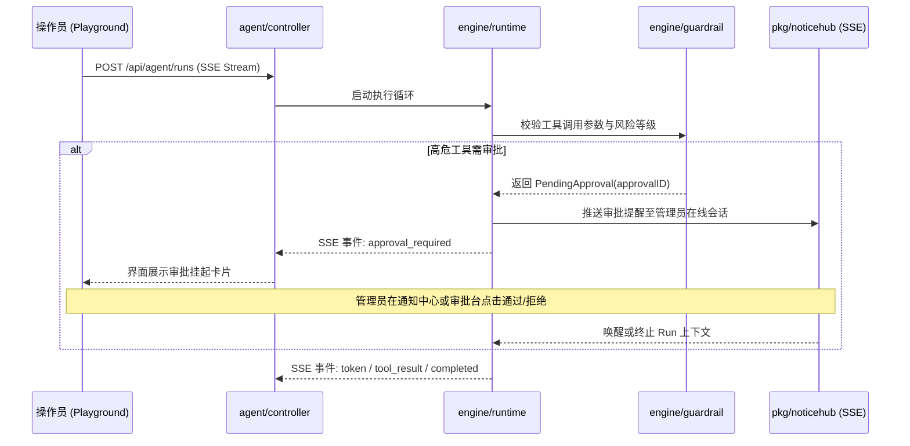

# Phase 2 架构蓝图：ZEV 业务侧 Agent Harness 子系统

> 状态：**已交付落地（M2.1–M2.3 主干能力已实现并通过全量架构与单测校验）**。本文档定义在 ZEV 业务平台中 `agent` 模块的边界、数据模型、引擎抽象、前端视图与分期里程碑，实际研发与演进受 Phase 1 仓库级 Harness 守卫与 `docs/exec-plans/` 长任务账本保护。

---

## 1. 目标与非目标

### 目标
- 在 ZEV 后台提供**可控、可观测、可审批、可评测**的企业级 AI Agent 运行时与管理控制台。
- 作为独立业务模块 `zev-go/modules/agent` 通过 `modules.Register(&AgentModule{})` 接入，零侵入 `modules/system`。
- 全量复用 ZEV 现有安全与实时通信底座：`middleware.AuthMiddleware` / `RequirePermission` / `DataScopeMiddleware` / `OperLogMiddleware`、以及 `pkg/noticehub` SSE 通知总线。

### 非目标（首期不做）
- 不自研底层大模型推理引擎或向量数据库内核（通过 HTTP Provider 与 pgvector / 外部 RAG 接口对接）。
- 不在首期开放无沙箱限制的任意宿主机 Shell 执行工具。

---

## 2. 后端模块设计 (`zev-go/modules/agent/`)

严格遵循 ZEV 三层架构，并将核心执行引擎隔离在纯 Go `engine/` 子包内，与 Gin/GORM 解耦以便单元测试：

```text
zev-go/modules/agent/
├── init.go                  # 注册 AgentModule，AutoMigrate，挂载 /api/agent/* + RBAC
├── entity/
│   ├── provider.go          # 模型供应商配置（OpenAI 兼容 / Anthropic / Gemini / Ollama）
│   ├── agent.go             # Agent 定义（System Prompt、Model 绑定、工具白名单、步数/Token 预算）
│   ├── run.go               # 单次执行会话（状态、输入摘要、Token 用量、总耗时、DataScope）
│   ├── run_span.go          # 全链路 Span 树（LLM / Tool / Guardrail / Approval 耗时与状态）
│   ├── approval.go          # Human-in-the-Loop 高危工具挂起审批单
│   └── eval.go              # 评测集、用例与历史评测报告
├── dto/                     # 全部 Req/Resp 校验结构（受 GO-CTRL-NO-LOCAL-DTO 守卫）
├── controller/              # 极轻路由层（含 SSE 运行流接口，受 GO-CTRL-* 守卫）
├── service/                 # Provider 管理、Agent 编排、Run 调度、审批、Eval 执行器
└── engine/                  # 无框架耦合的核心 Harness 运行时
    ├── provider/            # 统一 Chat/Stream/ToolCall 客户端 + 重试与熔断
    ├── runtime/             # ReAct / Tool-Use 执行循环、步数/预算熔断、Context 裁剪
    ├── tool/                # Tool Registry + 内置受 RBAC 约束的只读工具 + MCP Client 适配器
    ├── guardrail/           # 输入/输出脱敏（复用 pkg/logger 脱敏规则）+ 策略拦截
    └── evaluator/           # 确定性断言（JSON Schema/正则）+ LLM-as-a-Judge 评分器
```

### 关键交互流：高危工具的人机审批（Human-in-the-Loop）



---

## 3. 前端管理界面设计 (`zev-web/apps/admin/src/pages/agent/`)

严格遵循极简黑白灰美学与“页面内禁止顶部正副标题”规范，通过 [components.tsx](../../zev-web/apps/admin/src/router/components.tsx) 注册懒加载视图：

| 菜单路径 | 页面模块 | 核心能力与复用组件 |
| :--- | :--- | :--- |
| `/agent/provider` | `agent/provider` | 模型网关配置、API Key 脱敏展示、连通性探活（`ZevTable` + RHF/Zod） |
| `/agent/workspace` | `agent/workspace` | Agent 编排中心（Prompt、模型绑定、工具白名单、护栏阈值与预算配额） |
| `/agent/playground` | `agent/playground` | SSE 流式调试台：推理过程折叠、Tool Call 卡片、审批挂起与恢复交互 |
| `/agent/traces` | `agent/traces` | 执行轨迹 Trace 检索 + Span 瀑布流抽屉（复用 `@zev/ui/components/tracker` 与 `Sheet`） |
| `/agent/evals` | `agent/evals` | Eval 数据集管理、回归对比曲线与通过率环比徽章（复用 `@zev/ui/components/chart` + `delta-badge`） |

---

## 4. 建议分期里程碑

实施时使用 `node scripts/harness/cli.mjs plan new agent-module` 创建长任务账本分期推进：

1. **M2.1 基础运行时与网关**：完成 `provider` / `agent` / `run` 实体与 CRUD、`engine/provider` 统一客户端、`playground` SSE 流式对话。
2. **M2.2 工具编排、护栏与审批闭环**：落地 `engine/tool`（内置受 RBAC 与 DataScope 约束的只读查询工具）+ `engine/guardrail` + `pkg/noticehub` 人机审批联动。
3. **M2.3 全链路可观测与评测回归**：落地 `run_span` Trace 瀑布面板、MCP Server 外部工具接入、`eval` 自动化回归评测与发布门禁。
