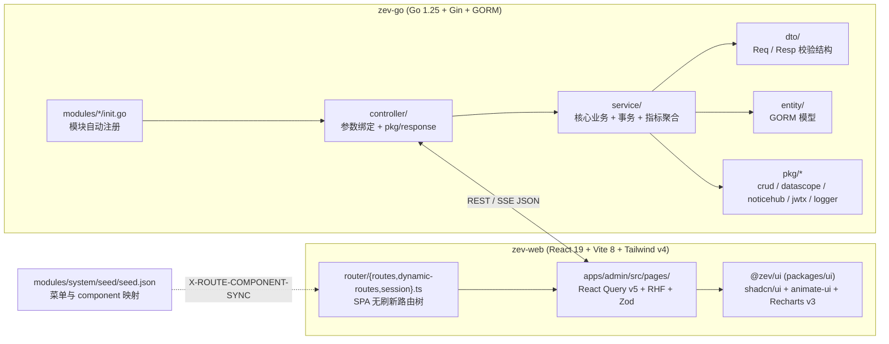

# ZEV 系统架构地图与 Harness 手册

本文档整合 ZEV Monorepo 的前后端模块结构、动态路由会话机制以及仓库级 Agent Harness 机械化守卫规则。

---

## 1. 系统全局结构与分层约束



### 后端核心底座清单 (`zev-go/pkg/`)

| 包路径 | 职责 |
| :--- | :--- |
| [pkg/crud](../../zev-go/pkg/crud/controller.go) | 基于 Go 泛型的标准 CRUD Controller 与 Service 基类 |
| [pkg/response](../../zev-go/pkg/response/response.go) | 统一 JSON 响应格式 `{ code, data, msg }` |
| [pkg/datascope](../../zev-go/pkg/datascope/datascope.go) | 行级数据权限过滤（全部 / 本部门 / 本部门及以下 / 仅本人 / 自定义） |
| [pkg/middleware](../../zev-go/pkg/middleware/rbac.go) | JWT 认证、RBAC 权限校验、DataScope 上下文注入、异步操作日志 |
| [pkg/noticehub](../../zev-go/pkg/noticehub/hub.go) | 基于内存与 SSE 的实时消息推送中心 |
| [pkg/logger](../../zev-go/pkg/logger/logger.go) | `slog` 结构化日志、请求链路 `RequestID` 与敏感字段脱敏 |

---

## 2. 前端动态路由与无刷新会话链路

前端路由从后端 `/api/system/user/info` 返回的菜单树动态生成，不再依赖硬编码路由或整页重定向：

1. **组件注册表**（[components.tsx](../../zev-web/apps/admin/src/router/components.tsx)）：将后端菜单 `component` 字符串（如 `system/user/index`）映射为 `React.lazy()` 懒加载组件（由 `withSuspense` 包裹）。
2. **动态 + 静态路由树构建**（[dynamic-routes.ts](../../zev-web/apps/admin/src/router/dynamic-routes.ts)、[static-routes.ts](../../zev-web/apps/admin/src/router/static-routes.ts)）：
   - `M` 目录类型创建父路由与自动重定向；
   - `C` 菜单类型从 `componentMap` 解析懒加载页面；
   - `F` 按钮类型跳过路由生成，仅用于权限判定；
   - `/profile` 与 `/messages` 通过静态路由保底挂载。
3. **运行时无刷新会话桥接**（[session.ts](../../zev-web/apps/admin/src/router/session.ts)）：
   - 登录成功、登出或 `401` 失效时统一调用 `syncRouterRoutes(menus)` / `clearSessionAndRedirectToLogin()`，在运行时更新 `router.update({ routeTree })`、清空 `useTagsStore` 与 `queryClient`，保持 `RootLayout` 稳定引用不卸载。

---

## 3. 机械化架构守卫字典 (`scripts/harness/cli.mjs check`)

Harness 仅保留“**编译器与 Biome 抓不到、零误报、踩中必出架构腐化或线上事故**”的 9 条硬守卫：

| 规则 ID | 执行器 | 拦截内容 |
| :--- | :--- | :--- |
| `GO-CTRL-NO-GORM` | [archcheck](../../zev-go/cmd/archcheck/main.go) | `controller/*.go` 严禁导入 `gorm.io/*` 或直接访问 `.DB` |
| `GO-CTRL-NO-LOCAL-DTO` | [archcheck](../../zev-go/cmd/archcheck/main.go) | `controller/*.go` 禁止定义非 `*Controller` 结构体 |
| `GO-CTRL-USE-RESPONSE` | [archcheck](../../zev-go/cmd/archcheck/main.go) | `controller/*.go` 禁止绕过 `pkg/response` 直接调用 `c.JSON` 等 Gin 响应 |
| `GO-LAYER-DEPENDENCY` | [archcheck](../../zev-go/cmd/archcheck/main.go) | 强制单向分层依赖（`entity`/`dto`/`service` 禁止反向依赖，跨模块禁引他模块 `controller`） |
| `FE-NO-FORCEMOUNT` | [frontend.mjs](../../scripts/harness/checks/frontend.mjs) | 禁止弹出层 `forceMount`，校验 `dropdown-menu.tsx` 保留防穿透类 |
| `FE-ANIMATE-UI-REGISTRY` | [frontend.mjs](../../scripts/harness/checks/frontend.mjs) | `animate-ui/` 下 `cn` 必须导入自 `@zev/ui/lib/utils` 且无未使用 `import * as React` |
| `FE-NO-UNSAFE-BROWSER-API` | [frontend.mjs](../../scripts/harness/checks/frontend.mjs) | 禁止 `window.alert/confirm/prompt` 与非白名单 `window.location` 硬跳转 |
| `FE-STACK-GUARD` | [frontend.mjs](../../scripts/harness/checks/frontend.mjs) | 禁止 `tailwind.config.*` 与 `vaul`，校验 `components.json` 及 `recharts >= 3` |
| `X-ROUTE-COMPONENT-SYNC` | [contract.mjs](../../scripts/harness/checks/contract.mjs) | 校验 `seed.json` 页面菜单 `component` 在前端 `componentMap` 100% 注册 |

### 行级豁免语法

确有极特殊场景（如 Controller 自定义流式输出）需要豁免某条规则时，必须在违规行或紧邻上一行注明**非空原因**：

```go
// harness:allow GO-CTRL-USE-RESPONSE 演示自定义纯文本导出流
ctx.String(200, payload)
```

---

## 4. 防熵增巡检 (`scripts/harness/cli.mjs entropy`)

按需运行，不阻塞日常开发与提交，用于定期清理系统腐化信号：
- `ENTROPY-DOC-LINKS`：检查核心文档内的相对路径是否存在死链；
- `ENTROPY-DOC-DRIFT`：检查文档是否残留已淘汰技术方案表述；
- `ENTROPY-SWAGGER-DRIFT`：提示 `controller/dto` 更新后是否需要刷新 `swagger.json`；
- `ENTROPY-ORPHAN-FILES`：检测前端 `src/api/` 中未被引用的孤儿定义；
- `ENTROPY-HOTSPOTS`：列出超过 500 行的前后端大文件观察榜单。
